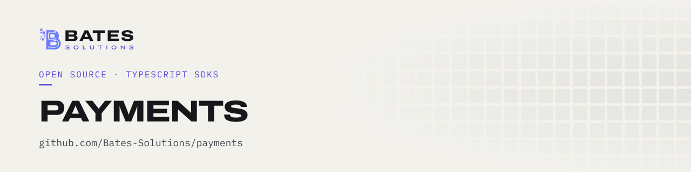

<a href="https://bates-solutions.com/?utm_source=github&utm_medium=readme&utm_campaign=payments">
  <picture>
    <source media="(prefers-color-scheme: dark)" srcset=".github/assets/readme-banner-dark.svg">
    
  </picture>
</a>

# payments

TypeScript payment provider libraries from Bates Solutions, in one repo.

[](https://github.com/Bates-Solutions/payments/actions/workflows/ci.yml)
[](LICENSE)

| Package                          | Provider                | JSR                                                                                                                  | API docs                                                          |
| -------------------------------- | ----------------------- | -------------------------------------------------------------------------------------------------------------------- | ----------------------------------------------------------------- |
| `@bates-solutions/squareup`      | Square                  | [](https://jsr.io/@bates-solutions/squareup)           | [docs](https://bates-solutions.github.io/payments/squareup/)      |
| `@bates-solutions/stripe`        | Stripe                  | [](https://jsr.io/@bates-solutions/stripe)               | [docs](https://bates-solutions.github.io/payments/stripe/)        |
| `@bates-solutions/clover`        | Clover                  | [](https://jsr.io/@bates-solutions/clover)               | [docs](https://bates-solutions.github.io/payments/clover/)        |
| `@bates-solutions/payments-core` | Shared primitives (0.x) | [](https://jsr.io/@bates-solutions/payments-core) | [docs](https://bates-solutions.github.io/payments/payments-core/) |

All four packages are developed and released from this repo. The old `Bates-Solutions/squareup`,
`stripe` and `clover` repos are archived; their history and tags (renamed `<package>-v<version>`)
are here.

Report problems in this repo's [issues](https://github.com/Bates-Solutions/payments/issues), naming
the package.

## Install

Each package is published on [JSR](https://jsr.io/@bates-solutions). On Node, they need version 22
or later.

```bash
# npm / pnpm / yarn (via JSR's npm compatibility)
npx jsr add @bates-solutions/squareup

# Deno
deno add jsr:@bates-solutions/squareup
```

`@bates-solutions/squareup` and `@bates-solutions/stripe` also need their provider's SDK (`square`
and `stripe`) as a peer dependency. Each package's README covers its setup and usage.

## Documentation

The API reference for every package is at https://bates-solutions.github.io/payments/, one path
per package (for example [/stripe/](https://bates-solutions.github.io/payments/stripe/)). Each
package also has hand-written guides in `packages/<name>/docs/`.

- `npm run docs` regenerates each package's markdown API reference in `packages/<name>/docs/api/`,
  which is committed and readable on GitHub.
- `npm run docs:site` builds the HTML site into `site/` (`scripts/build-site.mjs`): typedoc HTML
  for each package plus an index page. It does not touch the committed markdown.

`.github/workflows/docs.yml` builds the site on pull requests that touch a package's source or docs
config, and deploys it to GitHub Pages on each such push to `main`.

## Development

```bash
npm ci
npm run check   # lint, typecheck, build and test every package, then the scripts' tests
```

### CI

GitHub Actions (`.github/workflows/ci.yml`) runs on every pull request, whatever its base branch,
and on every push to `main`. It checks only the packages a change affects: a change under
`packages/<name>/` checks that package, a change to root config, `.github/` or `scripts/` checks
every package, and a change to root docs (`README.md`, `LICENSE`) checks none. For each affected
package it runs lint, typecheck, build, tests with coverage and a JSR publish dry run, on
GitHub-hosted runners. The `ci-ok` check sums up the run.

### Releases

Releases are automated with [release-please](https://github.com/googleapis/release-please)
(`release-please-config.json`, `.release-please-manifest.json`) and `.github/workflows/release.yml`.
Each package has its own version, changelog and tags (`<package>-v<version>`, for example
`clover-v1.1.1`).

1. Commits use [Conventional Commits](https://www.conventionalcommits.org/). A `fix:` under
   `packages/<name>/` makes a patch release of that package, a `feat:` a minor one, and a `!` or
   `BREAKING CHANGE:` footer a major one. `chore:`, `docs:`, `ci:`, `test:` and `refactor:` make
   none.
2. On each push to `main`, release-please updates one open release PR. It bumps each changed
   package's `package.json`, `jsr.json` and `CHANGELOG.md`.
3. Merging the release PR tags each package and creates its GitHub release. The workflow then
   publishes those versions to JSR over GitHub OIDC, with provenance. It skips any version JSR
   already has.

Never bump versions, create tags or run `jsr publish` by hand.

Releases before the move were made from the old repos, which are archived. Their tags were imported
here as `<package>-v<version>`.

## Security

Please report a vulnerability privately, as described in
[SECURITY.md](https://github.com/Bates-Solutions/.github/blob/main/SECURITY.md). Don't open a
public issue for it.

## Contributing

Contributions are welcome. See
[CONTRIBUTING.md](https://github.com/Bates-Solutions/.github/blob/main/CONTRIBUTING.md) and the
[code of conduct](https://github.com/Bates-Solutions/.github/blob/main/CODE_OF_CONDUCT.md).

## License

[MIT](LICENSE).

---

<a href="https://bates-solutions.com/?utm_source=github&utm_medium=readme&utm_campaign=payments">
  <picture>
    <source media="(prefers-color-scheme: dark)" srcset="https://raw.githubusercontent.com/Bates-Solutions/.github/main/brand/bates-solutions-on-dark.svg">
    
  </picture>
</a>

Made by [Bates Solutions](https://bates-solutions.com/?utm_source=github&utm_medium=readme&utm_campaign=payments).
